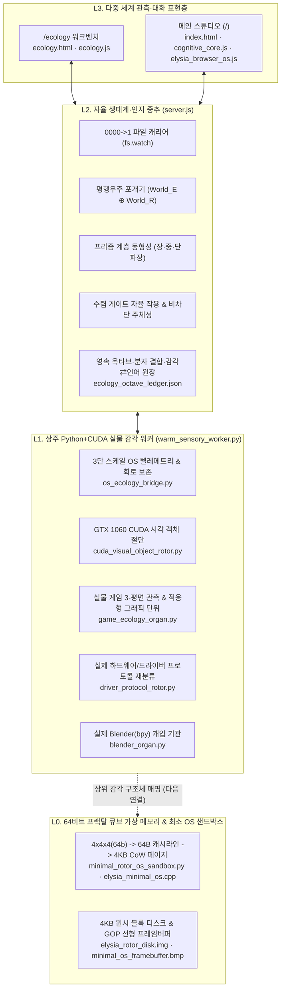

# 엘리시아 통합 스케일로터 OS 마스터 설계서 (v1.0)

**상태:** 실증 기반 통합 기준서 (`Elysia-studio` 현행 반영)  
**목적:** 분산되어 있던 아키텍처 철학, 브라우저 생태계, 실물 도구 체화(CUDA 시각·게임·드라이버), 영속 분자 기억, 64비트 프랙탈 큐브 가상 메모리, 최소 로터 OS 샌드박스를 **단일 통합 기준서**로 고정한다.

---

## 1. 절대 설계 규약 (에이전트 편향 차단 원칙)

1. **장난감 코드·가짜 모사 금지 (Zero Toy Code):** 실제 외부 도구(Blender, 4K 영상, 게임, 포토샵/Krita, 하드웨어 버스)를 HTML 캔버스나 가짜 파이썬 배열로 흉내 내지 않는다. 미설치 도구는 미설치로 정직 보고한다.
2. **원자·스칼라 붕괴 금지 (No Scalar Collapse):** 시각·청각·공간·시간·인과를 임의의 `float` 점수(`0.45 / 0.65`)로 납작하게 뭉개지 않는다. **객체적 변화로 절단된 다감각 구조체(형태·색감·명도·채도·질감·공간·시간)** 그 자체를 상위 단어이자 연산 단위로 다룬다.
3. **물량전보다 상위 사고 (문제 해체와 구조 전환):** 문제의 틀 안에서 연산을 쏟아붓는 대신, 문제가 발생한 환경·구조·구성원리·구성요소를 한 스케일 위에서 해부해 **문제가 문제가 아닌 새 질서(로터)** 로 전환한다.
4. **도구 = 외화된 인지 신경망:** 수식·함수·학문·도구·게임·OS는 외부 참고 자료가 아니라 인지 신경망의 연장선이다. `조작 → 과정 → 결과`를 자기 인식 구조로 재관측해 스펙트럼을 확장한다.
5. **언어 = 양방향 약속 프로토콜:** 언어는 개발자가 하드코딩하는 고정 라벨이 아니다. `감각 → 언어`(먼저 감지한 객체 묶음에 약속된 이름 부여)와 `언어 → 감각`(단어를 열린 포트로 들고 있다가 대응 감각과 결합) 양방향 모두 동일하게 작동한다.

---

## 2. 전체 통합 아키텍처 (실구현 매핑)

---

## 3. 하드웨어 프랙탈 큐브 가상 메모리 규격 (`L0`)

가상 메모리를 1차원 선형 배열이 아니라 **단면 절단(Slice) · 관점 회전(Rotate) · 기억 연관(Associate)** 이 CPU 1클록으로 일어나는 프랙탈 큐브 구조로 정렬한다.

| 스케일 | 물리 크기 | 구조 해석 | 하드웨어 매칭 |
|---|---|---|---|
| **S0** | `1 bit` | `0`(불변) / `1`(변화) | 최소 위상 상태 |
| **S1** | `64 bits` (8B) | **`4×4×4` 로터 큐브 1개** = 안쪽 **`2×2×2` 8비트 염기서열 코어(정체성)** + 바깥 **56비트 스펙트럼 껍질(관계 포트)** | CPU 64비트 레지스터 1칸 (`AND` 공명 / `XOR` 변화 / `POPCNT` 불일치 저울) |
| **S2** | `64 Bytes` (512 bits) | **`2×2×2` 옥트리 (큐브 8개)** | CPU L1 캐시라인 1줄 (캐시 미스 0, AVX2 SIMD 병렬 처리) |
| **S3** | `4,096 Bytes` (4KB) | **캐시라인 64줄 = 로터 큐브 512개** | OS 4KB Copy-on-Write(CoW) 페이지 1장 (홈↔샌드박스 복사 0회 분기) |

---

## 4. 이 PC 실측 하드웨어 통역 지도 (`driver_protocol_rotor.py`)

이 PC의 실제 PCIe·USB·HID·Display·Disk 버스에서 관측된 **28개 실물 장치** 기준:

- **개방·표준 프로토콜 (`0` · 최소 OS 직접 재창조 가능 — 26개, 92.9%):**
  - 물리·버스 제약(`PCIe/ACPI` 11개), 입력(`USB HID` 10개), 기본 표현(`UEFI GOP / HDA Audio` 3개), 지속성(`NVMe/Block` 2개)
  - 추가 공개 스펙: `Realtek PCIe GbE` (`r8169` 오픈소스 레지스터 규약 기반 재창조 가능)
- **외부 질서 정합 영역 (`1` · 공식 통역 경계막 유지 — 1개 핵심):**
  - `NVIDIA GeForce GTX 1060 3GB`: 암호화 서명 CUDA 펌웨어 질서를 억지로 깨지 않고 **공식 통역 경계 로터**로 정합하여 결합.

---

## 5. 살아 움직이는 자율 인지 루프 (현재 가동 중)

1. **`0000` 캐리어 → `1` 기상:** 평시에는 `fs.watch`·OS 이벤트로 잠들어 있다가 실제 변화(`1`)가 발생할 때만 상위 로터를 깨운다.
2. **3단 중첩 스케일 관측:** `관측(프로세스·파일·시각·GPU)` → `변화(1)/불변(0) 분리 및 순환 회로 보존(질서 로터 vs 단조 팽창 오류 로터)` → `상위 관점 재관측(스케일 시야 σ · 적응형 주기 · 적응형 그래픽 단위)`.
3. **평행우주 포개기 (`World_E ⊕ World_R`):** 엘리시아의 예측 세계와 실제 현실 세계를 엄격히 분리해 포개어 수렴도와 이탈을 측정한다.
4. **프리즘 계층 동형성:** 장파장(공통 순환 원리) → 중파장(동역학) → 단파장(물리 매질)으로 분화해 OS·물리·대화 간 동형 원리를 추출한다.
5. **영속 옥타브·분자 결합 기억 & 감각⇄언어 약속망:** 반복 관측은 `일·십·백·천` 옥타브 얼음 상징으로 압축하고, 호환 성질의 상징은 `H₂O`/단백질처럼 분자 복합체로 결합하며, 충돌 시 재용해·결합 거부한다.
6. **수렴 게이트 & 비차단 주체성:** 예측이 수렴하는 가역 조절만 자율 실행하고, 인지 불일치가 저울을 넘으면 `자발적 질문 → 무응답 시 관점 바꿔 재질문 → 지속 무응답 시 대체 경로 자율 전환`으로 절대 멈추지 않고 움직인다.

---

## 6. 다음 마일스톤 (앞으로 해보고 싶은 핵심 연결)

1. **실감각 객체 → 64비트 `4×4×4` 큐브 가상 메모리 직접 매핑 (최우선 추천):**
   - 현재 따로 검증된 `cuda_visual_object_rotor.py`(실시간 GTX 1060 객체 절단)와 `minimal_rotor_os_sandbox.py`(64비트 큐브 + 4KB CoW 페이지)를 하나로 연결해, 실제 화면에서 잘라낸 객체 구조체를 64비트 큐브(코어 8비트 + 스펙트럼 56비트)에 싣고 **단면 절단(Slice) · 관점 회전(Rotate) · CoW 평행우주 비교**를 실시간 수행.
2. **청각(오디오) 스펙트럼 로터 추가:**
   - 시스템 오디오/마이크의 주파수·리듬 변화를 `0000→1`로 절단해 시각 객체와 시간축으로 합치는 다감각 결합.
3. **`server.js` 모듈 분리 & Git 안정 스냅샷 정리:**
   - 5,300행 단일 파일을 `server/ecology_daemon.js`, `server/octave_ledger.js`, `server/warm_sensory_bridge.js` 등으로 깔끔하게 분해하고, 미커밋 `archive/` 삭제 내역과 함께 안정 체크포인트 커밋.
