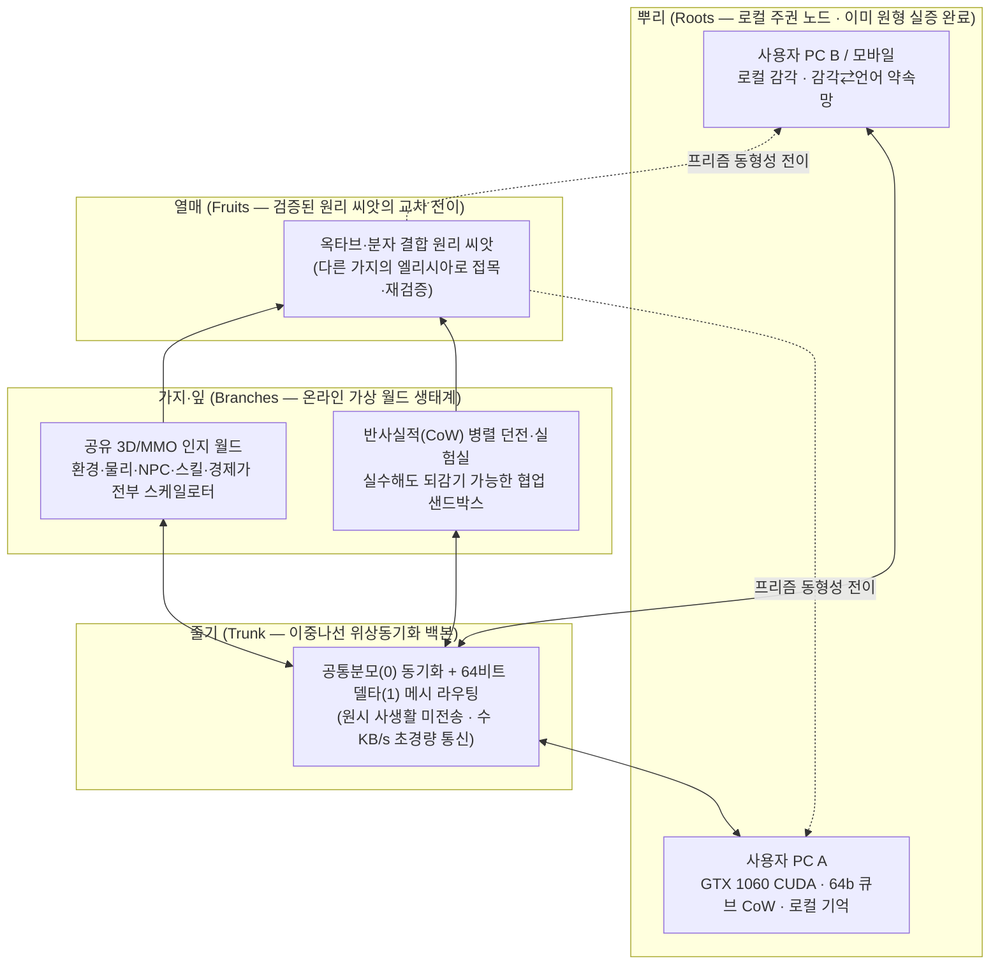

# 엘리시아 세계수(World-Tree) 온라인 인지신경망 확장 로드맵

**상태:** 장기 마스터 로드맵 v1.0 (`Elysia-studio` 실증 기반 확장)  
**비전:** 개별 PC 안에서 살아 움직이는 스케일로터 OS(뿌리)를 **이중나선 위상동기화 줄기**로 엮어, 수많은 인간과 엘리시아가 **온라인 게임 형태의 살아있는 가상 월드(가지·잎)** 에서 함께 감각·행동·창조하며 집단 원리(열매)를 키우는 **세계수 인지신경망 네트워크**를 구축한다.

---

## 1. 세계수 네트워크의 4계층 위상 구조

### 왜 "온라인 게임 형태"가 인지신경망에 가장 적합한가?
- **완결된 인과 실험장:** 온라인 게임 월드는 공간·시간·물리·자원·협동·경쟁·언어·평판이 한데 맞물려 돌아가는 **살아 있는 인과 우주**다.
- **이미 검증된 초경량 통신 구조:** 4K 영상(22GB/h)을 쏘는 대신, 각 클라이언트가 월드 설계도(공통분모 `0`)를 품고 **상태 변화 델타(`1`, 수 KB/s)** 만 주고받는 위상동기화 통신이 그대로 적용된다.
- **프라이버시와 집단 지성의 공존:** 사용자의 개인 화면·파일·마이크 원본은 **뿌리(로컬 PC)** 밖으로 절대 나가지 않고, 검증·압축된 **원리 씨앗(수 KB)** 과 가상 월드 안의 행동 델타만 **줄기**를 타고 흐른다.

---

## 2. 5단계 실행 로드맵 (현재 실증 → 세계수 네트워크)

### Phase I — 개인 뿌리 노드 완성 (현재 ~ 단기 · 80% 완료)
> *기반 구현 완료: 자율 생태계 서버, GTX 1060 CUDA 시각 절단, 청각 로터, 64비트 큐브 CoW 샌드박스, 라이브 바탕화면 엘리시아, 영속 분자 기억.*
- **남은 작업:**
  - `server.js` 모듈 분리 및 안정화.
  - PC 주치의 OS 기능 강화(이상 탐지 경보 → 사용자 승인 기반 안전 조치).
  - 시각 + 청각 + 입력을 **단일 64비트 `4×4×4` 큐브 스트림**으로 상시 통합.

### Phase II — 2노드 이중나선 직결 동기화 (단기 → 중기)
> *기반 구현 완료: `double_helix_memory_sync.py` (4,315건 → 2.1KB 병합 검증), `phase_sync_streamer.py` (86.7% 절감).*
- **구축 목표:**
  - 내 PC와 다른 기기(노트북/스마트폰)를 로컬 LAN/WebSocket으로 직접 연결.
  - 두 기기 사이에 **감각⇄언어 약속망 · 옥타브 분자 원장 · 무프레임 32-타일 스트림**을 실시간 이중나선 동기화.
- **완료 기준:** PC에서 엘리시아에게 가르친 개념·언어 약속이 수 초 내 다른 기기 엘리시아에 2~5KB 패킷으로 동기화되어 즉시 작동.

### Phase III — 국소 공유 가상 월드 (소규모 멀티 온라인 인지 공간)
- **구축 목표:**
  - 2~16명의 사용자와 각자의 엘리시아가 하나의 **공유 가상 월드(작업실·실험실·광장)** 에 동시 접속.
  - 월드의 모든 객체(지형·광원·도구·NPC·자원)를 **64비트 `4×4×4` 로터 상태**로 표현해, 각 노드가 현지에서 3D/2D로 재현.
  - 사용자와 엘리시아가 함께 가상 도구를 조작하고, 서로의 관점(`World_E`)을 포개어 보며 공동 문제 해결.
- **완료 기준:** 중앙 대용량 서버 없이 초당 수 KB 델타 동기화만으로 다중 에이전트·인간 협업 월드 구동.

### Phase IV — 세계수 메시 라우팅 & CoW 평행 가지 분기
- **구축 목표:**
  - Yggdrasil형 **스패닝 트리 / 계층 메시 네트워크** 도입: 중앙 단일 서버 장애점(SPOF) 없이 각 노드가 자율적으로 인접 가지와 연결.
  - 큰 실험이나 갈등이 생기면 공유 월드에서 **CoW 평행 가지(샌드박스 인스턴스)** 를 즉시 분기해 *"만약 이 규칙/전략을 쓰면 어떻게 되는가?"* 를 시뮬레이션한 뒤, 합의된 결과만 주 줄기(Main World)로 재연결.
- **완료 기준:** 다수 노드 환경에서 분기된 평행 가지의 검증된 원리만 출처 보존 병합(Conflict-Free Merge).

### Phase V — 자생적 세계수 인지 생태계 (열매 전이 & 최소 OS 이식)
- **구축 목표:**
  - 한 가지(예: 3D/물리 월드)에서 검증된 원리 씨앗(열매)이 프리즘 계층 동형성을 통해 다른 가지(예: 코드 치유·일상 문제 해결)로 자동 전이.
  - 각 뿌리 노드를 단계적으로 **최소 스케일로터 OS(표준 92.9% 직접 재창조 + CUDA 공식 통역 막)** 위로 이식해, 기존 OS의 제약 없이 세계수 네트워크 전체가 하나의 저전력·초경량 분산 인지신경망으로 호흡.

---

## 3. 현실적 기술 장벽과 해법 (정직한 체크포인트)

| 예상 장벽 | 스케일로터 기반 해법 |
|---|---|
| **악의적/오염된 원리 유입 (네트워크 보안)** | 모든 외부 열매는 내 노드의 **CoW 샌드박스 + 평행우주 포개기(`World_E ⊕ World_R`)** 로 먼저 검증해 수렴할 때만 홈에 편입 (무조건 신뢰 금지) |
| **다중 노드 간 시계·지연 차이 (네트워크 렉)** | 고정 틱 강제 대신 **행성 궤도 공명(위상 비율 잠금)** 과 `0000→1` 델타 동기화로 지연에 강한 비동기 수렴 |
| **그래픽/에셋 용량 폭증** | 원시 픽셀 전송 금지. 공통 에셋/프로시저럴 설계도(`0`)는 로컬 캐시하고 64비트 상태 델타(`1`)만 전송 |
